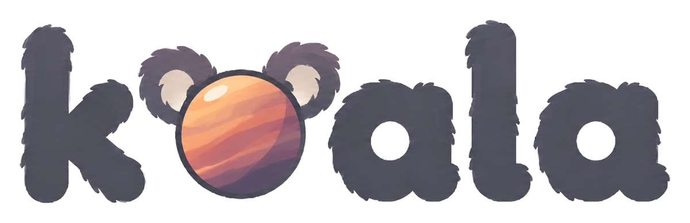
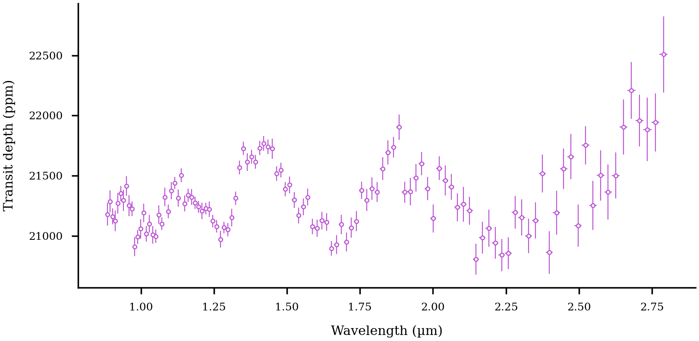

<p align="center">
  
</p>

# koala

[](https://github.com/TylerFair/koala/actions/workflows/tests.yml)
[](https://koala-jwst.readthedocs.io)

koala fits JWST transit, eclipse and phase-curve light curves.
It fits the white-light curve to measure the orbit, then fits every wavelength channel, and gives you back a spectrum along with the fitted light curves and posteriors.
It's built on JAX and NumPyro, so the same fit runs on a laptop or a GPU, and every integration goes into the fit.



## Installation

koala needs Python 3.10 or newer and Git:

```bash
conda create -n koala python=3.11
conda activate koala
git clone https://github.com/TylerFair/koala.git
cd koala
python -m pip install .
```

For GPUs, and for Harmonica (which needs a C++ compiler), see the [installation page](https://koala-jwst.readthedocs.io/en/latest/install.html).

## Usage

The repository comes with a WASP-39 b NIRISS/SOSS observation to try it on:

```bash
koala -c examples/niriss_soss_order1.yaml
```

[Your first fit](https://koala-jwst.readthedocs.io/en/latest/quickstart.html) walks through that example, and the [documentation](https://koala-jwst.readthedocs.io) covers the rest.

## Citing

If koala helps your research, please cite this repository and the commit you used.
[Citing koala](https://koala-jwst.readthedocs.io/en/latest/reference/citing.html) lists the software koala builds on, which deserves credit too.

## Contributing

Bug reports and pull requests are very welcome on [GitHub](https://github.com/TylerFair/koala/issues).
See [contributing and testing](https://koala-jwst.readthedocs.io/en/latest/reference/development.html) to get started.
koala is released under the BSD 3-Clause license (see [LICENSE](LICENSE), and [licenses/](licenses/) for the code it includes from other projects).
